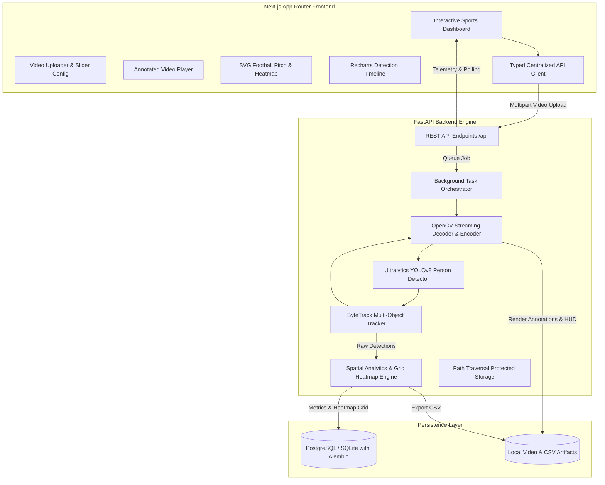

# FootVision AI - Full-Stack AI Football Analytics Platform

FootVision AI is an end-to-end, production-minded computer vision analytics platform designed for football match analysis. Users upload match footage to automatically detect footballers across every frame, maintain persistent tracking identities across temporal occlusions via ByteTrack, generate pitch-space position heatmaps, inspect real-time timeline detection counts, and export structured telemetry records as CSV.

---

## 1. System Architecture



---

## 2. Key Features

- **Automated Player Detection:** Pretrained Ultralytics YOLOv8 deep learning model filtered to COCO person class (0).
- **Persistent Multi-Object Tracking:** ByteTrack tracking using Kalman filtering and Hungarian matching to assign and maintain temporary player IDs.
- **Sleek Annotated Video Generation:** Generates output MP4 streams featuring lime green bounding boxes, player ID badges, confidence levels, foot anchor points, and a broadcast-style telemetry HUD (frame count, active players, timestamp).
- **Spatial Position Heatmaps:** Image-space normalized 2D density grid projected onto an SVG international football pitch with visual density gradients.
- **Detection Timeline Graphs:** Dynamic Recharts area chart visualizing player density and camera presence over match time.
- **Player Track Statistics:** Tabular view of frame appearance frequency, first seen timestamp, last seen timestamp, and track continuity duration.
- **One-Click CSV Export:** Structured tabular export of all frame numbers, timestamps, track IDs, confidences, and bounding box coordinates `[x1, y1, x2, y2]`.
- **Asynchronous Background Processing:** Database-backed job statuses (`queued`, `processing`, `completed`, `failed`) with polling updates that auto-terminate upon completion.
- **Safe Artifact Management:** UUID-based storage names, path traversal prevention, and synchronized file cleanup upon analysis deletion.

---

## 3. Technology Stack

### Frontend
- **Framework:** Next.js (App Router)
- **Language:** TypeScript (Strict Mode enabled)
- **Styling:** Vanilla CSS + Tailwind CSS (Curated Dark Sports-Tech Palette)
- **Charts:** Recharts
- **Pitch Visualization:** Scalable SVG with calibrated pitch markings and heatmap density gradients
- **Icons:** Lucide React

### Backend
- **Framework:** FastAPI & Uvicorn
- **Language:** Python 3.11+ (Python 3.13 verified)
- **Computer Vision:** OpenCV (`opencv-python`)
- **AI & Tracking:** Ultralytics YOLOv8 (`yolov8n.pt`) + ByteTrack (`lap` solver)
- **Data Analytics:** Pandas & NumPy
- **Database & ORM:** SQLAlchemy 2.x & Alembic (PostgreSQL production-ready with SQLite fallback)

---

## 4. Difference Between Detection, Tracking, and Analytics

| Concept | Responsibility | Mechanism in FootVision |
| :--- | :--- | :--- |
| **Detection** | Locating where players are in an isolated single frame. | YOLOv8 predicts bounding boxes and confidence scores for person class. |
| **Tracking** | Associating detections across consecutive frames to maintain identity. | ByteTrack applies Kalman motion prediction and bipartite Hungarian matching to assign persistent `Track ID`s. |
| **Analytics** | Synthesizing raw spatial-temporal detections into actionable insight. | Pandas aggregates appearance duration, timeline frequency, and 2D spatial heatmap density. |

> **Note on Physical Metrics & Homography:**
> Raw pixel movements and image coordinates are projected as **image-space approximations**. Without multi-camera homography matrix calibration to pitch grass coordinates, pixel distance cannot be directly reported as physical distance in meters or sprint velocity in km/h.

---

## 5. Getting Started Locally

### Prerequisites
- Python 3.11+
- Node.js 18+ and npm
- (Optional) Docker and Docker Compose

### 1. Clone the Repository
```bash
git clone https://github.com/username/footvision-ai.git
cd footvision-ai
```

### 2. Backend Setup
1. Open a terminal and navigate to the project directory:
```bash
# Install Python dependencies
pip install -r backend/requirements.txt
```

2. Configure environment variables (create `.env` from `.env.example`):
```bash
cp .env.example .env
```

3. Run Database Migrations:
```bash
cd backend
alembic upgrade head
cd ..
```

4. Start FastAPI Backend:
```bash
uvicorn backend.app.main:app --host 0.0.0.0 --port 8000 --reload
```
The backend API is now live at `http://localhost:8000` (Interactive Swagger Docs at `http://localhost:8000/docs`).

### 3. Frontend Setup
1. In a separate terminal:
```bash
cd frontend
npm install
npm run dev
```
The frontend is now accessible at `http://localhost:3000`.

---

## 6. Docker & Containerized Deployment

Run the complete full-stack environment with PostgreSQL, FastAPI, and Next.js:

```bash
docker compose up --build
```

- **Frontend:** `http://localhost:3000`
- **Backend API:** `http://localhost:8000`
- **PostgreSQL:** Port `5432`

---

## 7. Running Automated Tests

### Backend Unit & Integration Tests (Pytest)
From the project root:
```bash
python -m pytest backend/tests -v
```
Test suite coverage includes:
- Health & Readiness check endpoints
- Video upload validation & format restrictions (MP4, AVI, MOV)
- File size boundary checks and parameter validation
- Analytics computation, track summaries, and CSV exports
- End-to-end pipeline execution with synthetic video generation, YOLO inference, and annotated MP4 video creation
- Full REST API lifecycle (create, get, paginate, retry, delete)

### Frontend Build & Type Validation
```bash
cd frontend
npm run build
```
Validates strict TypeScript types, Next.js page generation, and pre-rendering routes.

---

## 8. REST API Specification

| Method | Endpoint | Description |
| :--- | :--- | :--- |
| `GET` | `/api/health` | Service health status and loaded model info |
| `GET` | `/api/overview` | Platform KPI statistics (analyses count, total detections) |
| `POST` | `/api/analyses` | Upload video clip & queue asynchronous analysis |
| `GET` | `/api/analyses` | Paginated analysis history |
| `GET` | `/api/analyses/{id}` | Detailed analysis metrics, video metadata, and heatmap |
| `GET` | `/api/analyses/{id}/detections` | Paginated raw detection bounding boxes |
| `GET` | `/api/analyses/{id}/video` | Stream annotated video feed with HUD overlays |
| `GET` | `/api/analyses/{id}/export` | Download detection records as CSV |
| `POST` | `/api/analyses/{id}/retry` | Re-queue a failed video analysis job |
| `DELETE` | `/api/analyses/{id}` | Delete analysis record and prune video artifacts |

---

## 9. Model Details & Licensing Considerations

- **Model:** Ultralytics YOLOv8 Nano (`yolov8n.pt`)
- **Weights:** Official weights downloaded automatically via Ultralytics CDN.
- **License Note:** YOLOv8 is distributed under AGPL-3.0 by Ultralytics. For commercial usage requiring proprietary distribution, review Ultralytics licensing terms or replace with an Apache/MIT compatible detector.
- **Hardware Acceleration:** Automatically utilizes CUDA GPU if PyTorch detects an active NVIDIA device; falls back to multicore CPU inference seamlessly.

---

## 10. Security & Data Integrity

- **Path Traversal Protection:** Filenames are normalized to secure UUID hashes; file system access is strictly checked against resolved storage boundaries.
- **File Validation:** Binary content and extension boundaries are validated to reject non-video files.
- **Concurrency & Concurrency Locks:** Model inference utilizes thread locks to prevent race conditions during concurrent frame processing.
- **Safe Cleanup:** Cascade deletion drops related detection database rows and removes on-disk video and CSV artifacts without orphaned filesystem clutter.

---

## 11. Future Roadmap

1. **Camera Homography Calibration:** Interactive 4-point pitch keypoint selector to project image pixels to FIFA regulation pitch dimensions.
2. **Jersey Number Recognition:** Secondary OCR / fine-tuned crop model for automated player kit identification.
3. **Ball Tracking:** Specialized high-FPS ball detection model with trajectory prediction.
4. **Team Color Clustering:** K-Means clustering on torso bounding boxes to automatically segment home vs. away squads.
